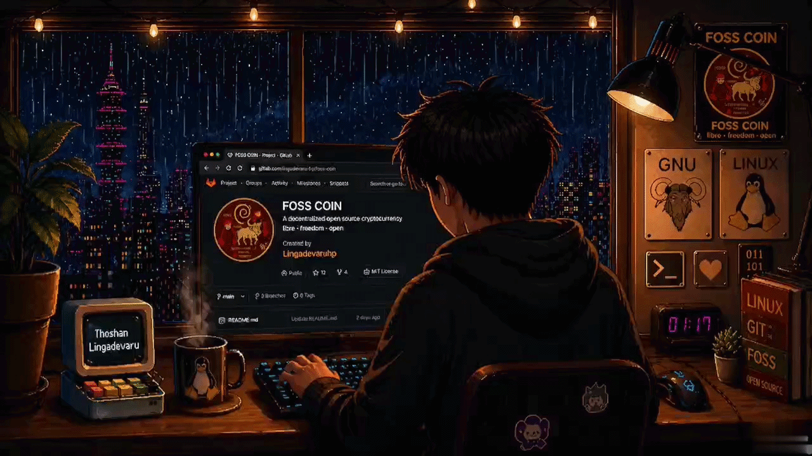

# Thoshan's Wiki

Personal editorial knowledge base for projects, systems, and technical notes.

## Featured project: FOSS Coin

The FOSS Coin article documents the Solana SPL token I created, its fixed supply, authority revocation, Orca Whirlpool listing, public transactions, and independent verification links. The article keeps the original project capture GIF as a lazy-loaded, fullscreen-openable media asset.



FOSS Coin is presented as a personal technical project and learning exercise, not as a financial product or an affiliation with the Free Software Foundation, GNU, or Linux.org.

Repository: [Foss-Token](https://github.com/lingadevaru-hp/Foss-Token)

## Technology

- **React 19** + **TypeScript** + **Vite 7** for the SPA
- **Wouter** for lightweight routing
- **Tanstack Query** for data fetching
- **TailwindCSS v4** with CSS custom property design tokens
- **shadcn/ui** component primitives (Radix UI)
- **Cloudflare Workers** for edge functions (Turnstile verification, TTS endpoint)
- **pnpm 10** workspace monorepo
- Dark-first theme, accessible controls, reduced-motion support
- Browser Web Speech API for optional article reading

## Local development

```bash
# Install dependencies
pnpm install

# Start wiki dev server
pnpm --filter @workspace/thoshan-wiki dev

# Typecheck all packages
pnpm typecheck

# Build all packages
pnpm build
```

## Project structure

```
wiki-website/
├── artifacts/
│   └── thoshan-wiki/       # Main wiki SPA
│       ├── src/
│       │   ├── components/  # UI components
│       │   ├── pages/       # Route pages
│       │   ├── data/        # JSON article data
│       │   └── index.css    # Design tokens + styles
│       └── public/          # Static assets
├── src/
│   └── worker.ts            # Cloudflare Worker (Turnstile, TTS)
├── lib/                     # Shared workspace packages
└── DESIGN_SYSTEM.md         # Design token documentation
```

## License

MIT
